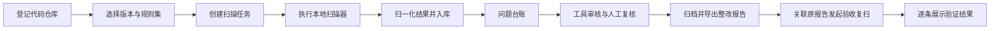
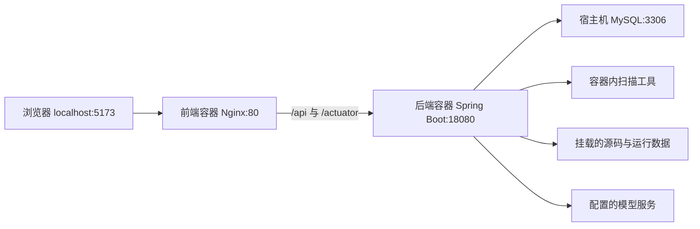

# CodeSentry

CodeSentry 是一个本地化代码审查产品。它读取已有本地 Git 仓库，或通过标准 Git 协议克隆远程仓库，执行全量扫描及基于指定分支的增量扫描，并提供工具审核、人工复核、整改报告及关联原报告的复扫验收。

## 技术框架

项目采用前后端分离架构。后端是按业务模块组织的 Spring Boot 应用，通过命令行调用本地扫描器；扫描和模型审核分别使用进程内线程池执行。

| 层次 | 技术 | 用途 |
| --- | --- | --- |
| 前端 | Vue 3、TypeScript、Vite 8 | 页面开发与构建 |
| 路由、状态 | Vue Router 5、Pinia 4 | 页面路由；Pinia 已接入，当前页面主要使用 Vue 响应式状态 |
| 页面样式 | 自定义 CSS 和 Vue 组件 | 应用布局、主题、表格及通用组件 |
| 后端 | JDK 11、Spring Boot 2.7.18 | 业务接口、扫描调度及报告生成 |
| 数据访问 | MyBatis Spring Boot Starter 2.3.2、MySQL | 项目、扫描结果、审核记录等持久化 |
| 后台任务 | Spring ThreadPoolTaskExecutor | 扫描任务与模型审核各使用独立线程池 |
| 模型接入 | OpenAI 兼容接口 | 工具初审与复审，模型服务可配置 |
| 报告导出 | Apache POI、OpenHTMLToPDF | Word、HTML、PDF |
| 部署 | Docker、Nginx | 后端运行环境及前端静态页面服务 |

**CodeSentry 自身使用 Java 11。项目设置中的“业务系统 Java 版本”指被扫描系统的运行版本，用于选择整改候选；例如当前业务项目使用 Java 8。两者分别配置。**

数据库启动初始化使用 Spring SQL 初始化脚本及 `DatabaseCompatibilityInitializer` 的字段兼容检查，当前未接入 Flyway。

## 项目目录

以下省略 `.git`、IDE 配置、`node_modules`、`target`、`dist` 等目录。

```text
CodeSentry/
├── codesentry-server/                       Java 后端工程
│   ├── pom.xml                             依赖及 Maven 构建配置
│   ├── Dockerfile                          后端多阶段镜像构建
│   ├── docker/
│   │   ├── install-scanners.sh              扫描工具安装脚本
│   │   └── fonts/                          报告使用的中文字体
│   └── src/
│       ├── main/
│       │   ├── java/io/codesentry/
│       │   │   ├── CodeSentryApplication.java  后端启动入口
│       │   │   ├── project/                项目、仓库配置与业务 Java 版本
│       │   │   ├── git/                    Git 操作、镜像仓库、提交快照
│       │   │   ├── scan/                   扫描任务、调度及扫描器适配
│       │   │   ├── finding/                问题台账、人工复核与整改建议
│       │   │   ├── ai/                     模型配置、初审、复审及密钥存储
│       │   │   ├── report/                 报告导出、清单归档及整改验收
│       │   │   ├── rule/                   规则集管理
│       │   │   ├── dashboard/              首页统计
│       │   │   ├── process/                外部命令、日志采集及任务取消
│       │   │   ├── config/                 线程池、数据库兼容、Web 等配置
│       │   │   └── common/                 统一响应及异常处理
│       │   └── resources/
│       │       ├── application.yml         后端配置
│       │       ├── db/migration/           数据库初始化 SQL
│       │       └── rules/                  内置 OWASP/CWE、前端扫描规则
│       └── test/                           后端测试和测试数据
├── codesentry-web/                          Vue 前端工程
│   ├── package.json                        依赖和 npm 命令
│   ├── vite.config.ts                      开发服务、路径别名、接口代理
│   ├── Dockerfile                          Node 构建、Nginx 发布
│   ├── docker/nginx.conf                   静态页面和后端接口代理
│   ├── scripts/                            浏览器检查脚本
│   └── src/
│       ├── main.ts                         前端启动入口
│       ├── App.vue                         根组件
│       ├── router/                         页面路由
│       ├── views/                          各功能页面
│       ├── components/                     页面布局与公共界面组件
│       ├── api/                            后端接口与请求封装
│       ├── types/                          TypeScript 数据类型
│       ├── utils/                          时间、主题、标签等工具
│       └── styles/                         全局样式
├── docker-compose.yml                      前后端构建和部署配置
├── scripts/                                启动、漏洞库更新等辅助脚本
├── docs/                                   架构、技术方案和操作文档
├── output/                                 本项目生成的文档及导出文件
├── tmp/                                    临时文件和调试输出
└── .codesentry/                            项目本地配置
```

后端业务模块通常按以下职责划分：

| 子目录 | 职责 |
| --- | --- |
| `controller` | 接收前端请求，返回统一接口响应 |
| `service` | 实现业务逻辑 |
| `mapper` | 使用 MyBatis 执行数据库操作 |
| `model` | 数据模型 |
| `dto` | 接口请求和响应对象 |
| `scan/engine` | 不同扫描器的适配实现 |
| `ai/provider` | 模型服务调用实现 |

## 核心流程与数据存储



- `ScanRunService` 创建任务，`ScanOrchestrator` 准备代码、执行扫描并更新任务状态。同一任务中的扫描器目前按顺序执行。
- 扫描器通过 `ScannerAdapter` 接口接入，结果转换为 `NormalizedFinding`，再由 `FindingPersistenceService` 保存。
- 全量扫描检查当前版本；普通增量扫描分别检查当前版本和基线分支的共同祖先，通过指纹识别新增、存量与已修复问题。
- 工具审核执行初审和复审，记录与人工结论分别保存。
- 台账保留扫描候选结果；报告按审核条件筛选、去重，同一依赖文件和组件版本的多个 CVE 可以合并展示。
- 首次导出报告或进入整改验收时归档问题清单；后续验收使用关联的全量复扫逐条比较。扫描未完整完成、规则集不一致或缺少原扫描器时，不将问题判为“未再检出”。

| 保存位置 | 内容 |
| --- | --- |
| MySQL | 项目、扫描批次、扫描器执行记录、问题及批次实例、人工结论、模型审核、模型配置、报告清单归档 |
| 运行数据目录 | Git 镜像、代码快照、扫描器原始报告、漏洞库缓存及本地工具文件等 |
| 项目 `output/`、`tmp/` | 手工生成的文档、调试和临时输出；不等同于后端运行数据目录 |

运行数据目录由 `CODESENTRY_STORAGE_ROOT` 指定，默认是后端运行账户的 `~/.codesentry`。当前 Docker 部署将其挂载到宿主机 `/Users/neo/.codesentry`：

```text
/Users/neo/.codesentry/
├── repositories/   远程 Git 镜像，使用时创建
├── snapshots/      各批次代码快照
├── reports/        各批次扫描器原始报告等文件
├── trivy-cache/    Trivy 漏洞库缓存
├── rules/          本地规则相关文件
├── tools/          本地工具相关文件
└── secrets/        密钥存储相关文件
```

备份和迁移应同时覆盖数据库、运行数据目录和必要的环境配置。项目源码目录里的 `.codesentry/` 与后端运行数据根目录分别管理。

## 设计文档

- [整体架构](docs/architecture.md)
- [技术调研方案总结](docs/CodeSentry-技术调研方案总结.md)
- [本地代码安全审核技术调研与实施流程](docs/代码安全审核技术调研与实施流程.md)
- [产品页面规划](docs/product-pages.md)
- [开发规划](docs/development-plan.md)
- [工具复核流程](docs/工具复核与人工审核流程.md)

## 本地开发启动

从项目根目录开始。开发环境需要 JDK 11、Maven、Node.js 22.12.0 或更高版本、npm、Git 和可访问的 MySQL；本地直接运行后端时，还需按下文准备扫描工具。Docker 镜像会安装扫描工具。


### 1. 初始化数据库

```sql
CREATE DATABASE codesentry DEFAULT CHARACTER SET utf8mb4 COLLATE utf8mb4_unicode_ci;
CREATE USER 'codesentry'@'localhost' IDENTIFIED BY 'change_me';
GRANT ALL PRIVILEGES ON codesentry.* TO 'codesentry'@'localhost';
FLUSH PRIVILEGES;
```

不要提交真实数据库密码。通过环境变量传入：

```bash
export CODESENTRY_DB_URL='jdbc:mysql://127.0.0.1:3306/codesentry?useUnicode=true&characterEncoding=utf8&useSSL=false&serverTimezone=Asia/Shanghai'
export CODESENTRY_DB_USERNAME='codesentry'
export CODESENTRY_DB_PASSWORD='change_me'
```

### 2. 启动后端

```bash
(cd codesentry-server && mvn spring-boot:run)
```

后端默认监听 `http://127.0.0.1:18080`。

### 3. 启动前端

```bash
(cd codesentry-web && npm ci && npm run dev)
```

前端默认监听 `http://127.0.0.1:5173`。开发时 Vite 将 `/api`、`/actuator` 代理到后端 `18080`；两个服务分别在各自终端运行。上述括号命令不会改变当前终端所在目录。

## Docker 部署与日常运维

### 部署结构



前端镜像先用 Node 构建，再用 Nginx 发布静态文件；运行阶段不依赖 Vite 开发服务。后端镜像先用 Maven 和 JDK 11 打包，再通过 Java 11 JRE 运行，并包含扫描工具和中文字体。

### 当前本机运行配置

以下为 **2026-11-04 核对的本机配置**，迁移环境时应按实际路径和数据库位置调整。

| 项目 | 当前配置 |
| --- | --- |
| Docker 运行环境 | macOS 上的 Colima |
| 前端容器 / 镜像 | `codesentry-web` / `codesentry-web:local` |
| 前端端口 | 宿主机 `5173` → 容器 `80` |
| 后端容器 / 镜像 | `codesentry-server` / `codesentry-server:local` |
| 后端端口 | 宿主机 `18080` → 容器 `18080` |
| 容器网络 | `codesentry-net` |
| 数据库 | 宿主机 MySQL，数据库名 `codesentry`；容器通过 `host.docker.internal:3306` 访问 |
| 数据目录 | `/Users/neo/.codesentry`，读写挂载 |
| 源码目录 | `/Users/neo/code`、`/Users/neo/harmonycloud/code`，只读挂载 |

当前前后端容器由独立 Docker 方式运行。本机尚无可用的 `docker compose` 或 `docker-compose` 命令；仓库中的 Compose 文件可用于安装 Compose 后的新环境部署或后续部署迁移。

### 重启、状态与日志

重启现有前后端，一行命令：

```bash
docker restart codesentry-server codesentry-web
```

常用检查命令：

```bash
docker ps
docker logs --tail 100 codesentry-server
docker logs --tail 100 codesentry-web
curl http://127.0.0.1:18080/actuator/health
```

浏览器入口：`http://127.0.0.1:5173`。

### 修改代码后的发布

从项目根目录构建两个镜像：

```bash
docker build -t codesentry-server:local codesentry-server
docker build -t codesentry-web:local codesentry-web
```

构建镜像后，还需要按原有环境变量、端口、网络和挂载配置重新创建对应容器。`docker restart` 只重启原容器，不加载刚构建的新镜像。重新创建后检查健康接口、页面和日志。

### 使用 Compose 部署

`docker-compose.yml` 包含前后端，不包含 MySQL 服务。准备步骤：

1. 准备 Docker、Compose 和可访问的 MySQL，初始化 `codesentry` 数据库及账号。数据库监听地址与账号授权需要允许后端容器连接。
2. 检查 Compose 文件中的宿主机数据目录、源码目录、端口和数据库地址，替换本机 `/Users/neo/...` 路径。
3. 通过环境变量配置 `CODESENTRY_DB_USERNAME`、`CODESENTRY_DB_PASSWORD`；需要模型审核时按实际服务配置密钥及地址。
4. 新环境从项目根目录启动：

   ```bash
   docker compose up -d --build
   ```

5. 后续通过相同的 Compose 配置和环境变量更新镜像、重新创建服务。

当前独立 Docker 容器占用相同的容器名和端口，迁移到 Compose 管理前需先记录并保留原配置，协调原容器的停止与替换，避免直接执行造成同名容器冲突。Compose 默认创建的网络与当前 `codesentry-net` 是两套部署配置。

## 关键配置入口

| 位置 | 用途 |
| --- | --- |
| `codesentry-server/src/main/resources/application.yml` | 数据库、端口、运行目录、扫描器及模型默认配置 |
| `codesentry-server/src/main/java/io/codesentry/config/CodeSentryProperties.java` | 后端配置对象和默认值 |
| `codesentry-web/vite.config.ts` | 开发服务与接口代理 |
| `codesentry-web/docker/nginx.conf` | Docker 前端页面服务与接口代理 |
| `docker-compose.yml` | 部署环境变量、端口、目录挂载及构建入口 |
| `codesentry-server/src/main/resources/rules/` | 内置扫描规则 |
| 仓库页面的“业务系统 Java 版本” | 被扫描系统的 Java 版本，用于筛选报告中的依赖整改候选 |

## 扫描工具准备

- Semgrep 用于 Java、JavaScript 和 JSP 专项规则扫描。
- Gitleaks 用于源码、配置和证书目录中的敏感信息检测。
- Trivy 默认执行 `vuln,secret`。Docker 扫描阶段只读取持久化缓存，不会在扫描任务中下载漏洞库；漏洞库和 Java 索引库通过独立维护命令更新。
- SpotBugs/FindSecBugs 用于没有 Java 源码的私有 JAR 字节码扫描。
- Alibaba P3C-PMD 2.1.1 使用官方 49 条 Java 开发规范规则扫描 `.java` 源码；纯 JSP 项目不会产生 P3C 结果。

```bash
# SpotBugs 可执行文件应在 PATH 中；FindSecBugs 插件通过环境变量指定
export CODESENTRY_FINDSECBUGS_PLUGIN=/path/to/findsecbugs-plugin.jar

# 下载官方 P3C-PMD 完整包；生产环境应同时按 Maven Central 提供的摘要校验文件完整性
mkdir -p "$HOME/.codesentry/tools"
curl -fL https://repo1.maven.org/maven2/com/alibaba/p3c/p3c-pmd/2.1.1/p3c-pmd-2.1.1-jar-with-dependencies.jar \
  -o "$HOME/.codesentry/tools/p3c-pmd-2.1.1-jar-with-dependencies.jar"

# 内网无法访问默认镜像时，可从公共 ECR 预下载后再离线扫描
trivy filesystem --db-repository public.ecr.aws/aquasecurity/trivy-db:2 \
  --download-db-only --no-progress
trivy filesystem --java-db-repository public.ecr.aws/aquasecurity/trivy-java-db:1 \
  --download-java-db-only --no-progress

# Docker 部署使用以下维护命令更新持久化缓存；下载缓慢时会沿用容器代理配置。
./scripts/update-trivy-db.sh
```

图片、视频、字体、Office 模板和压缩包默认不进入源码规则扫描；JSP、JavaScript、配置文件、标准 JAR 及历史遗留的 `.jar15/.jar37` 等归档仍会进入对应扫描器。

## 仓库扫描约束

- 本地目录模式不会执行 `git pull`，也不会切换用户当前分支。
- 当前工作区扫描可以包含未提交内容。
- 指定分支扫描通过 `git archive` 导出 Commit 快照，不创建 Git worktree。
- 远程仓库只使用标准 `git clone/fetch`，不调用 GitLab API、CI 或安全功能。
- 密钥、访问令牌和私钥不得写入项目配置；本地报告如包含真实代码证据，必须限制访问，并在对外交付前按约定处理敏感值。

## 误报复核与报告过滤

人工复核记录写入 `scan_triage`，不会删除扫描证据。问题台账保留全部候选结果。正式报告保留人工已确认的风险，或初审、复审均完成、各项可信度分别大于 65% 且非误报的工具结果。人工误报不进入报告。报告列表和三种导出格式共用筛选、去重与统计逻辑。首次导出或进入验收时另行保存报告清单归档，不改写或删除原始扫描问题；归档后报告列表及导出使用该清单。整改建议可根据已确认的业务 Java 版本和经核实的版本依据更新。
批量复核使用精确的扫描器、规则、路径和起始行选择器：

```bash
python3 scripts/triage-findings.py \
  --scan-run-id 7 \
  --selectors-file scripts/examples/codesentry-report-7-false-positives.json

# 确认 dry-run 输出无误后才写入复核记录
python3 scripts/triage-findings.py \
  --scan-run-id 7 \
  --selectors-file scripts/examples/codesentry-report-7-false-positives.json \
  --apply
```

脚本不会在参数文件中接收令牌；如接口开启认证，可通过
`CODESENTRY_API_TOKEN` 环境变量提供 Bearer token。

## 工具复核与人工审核

在问题台账中执行“批量工具审核”，通过“执行详情”查看进度、初审与复审建议及真实失败原因。整批结束后会自动重试失败项一次，也支持手动重试。

工具服务由后端配置启用，所需凭据由运行环境提供。启用外部工具时，必要真实源码证据会提交至配置接口，可能包含命中凭据。工具结论独立保存，不自动覆盖人工审核状态。

设置页面的工具开关、服务地址和模型写入 `ai_runtime_configuration`；该配置方式的 API Key 可通过 macOS Keychain 保存，非 macOS 或容器环境可通过环境变量注入。“工具管理”中的多工具配置写入 `ai_tool_configuration`，密钥加密保存，解密主密钥位于运行数据目录的 `secrets/ai-tools-master.key`。迁移时需要同时保留数据库及对应密钥文件。

审核人员可在“人工复核”中确认风险、标记误报、接受风险或登记整改待验证。完整流程见[工具复核与人工审核流程](docs/工具复核与人工审核流程.md)。

## 整改报告与复扫验收

1. 导出或查看报告，核对归档清单中的问题编号 `F-...`。
2. 根据报告修改业务代码或依赖，在“整改验收”中记录整改说明、提交编号和记录人。
3. 从原报告发起验收复扫，使用同一项目、同一规则集检查整改后的完整代码。
4. 在原报告中选择验证批次，逐条查看“仍然存在”“复扫未再检出”“同类风险待复核”或“尚未完成验证”。

“复扫未再检出”表示本次完整扫描没有命中，不等同于人工验收通过。同文件同类规则仍命中时，即使修改导致指纹变化，也会提示复核。此前未归档的旧导出文件无法自动还原历史清单，首次进入验收时应核对当前归档范围。

依赖整改正文保留当前组件、升级或迁移候选、处理步骤和验证要求，长链接集中放在附录。候选版本需要在业务系统中进行兼容性验证；没有可靠修复版本的条目会说明实施限制，不将单个补丁视为全部漏洞已修复。
