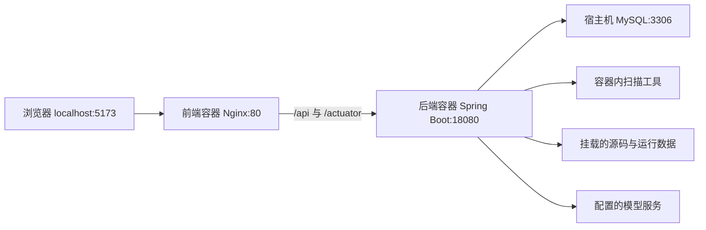

# CodeSentry

[Excel 功能清单](docs/CodeSentry功能清单.xlsx) / [在线查看功能清单](docs/CodeSentry功能清单.md)（按当前实现整理，包含使用范围及功能边界）。

CodeSentry 是一个本地化代码审查产品。它读取已有本地 Git 仓库，或通过标准 Git 协议克隆远程仓库，执行全量扫描及基于指定分支的增量扫描，并提供工具审核、人工复核、整改报告及关联原报告的复扫验收。

## 安全审核分类与结果复用

单资产和业务项目汇总报告下载均使用“项目名称安全扫描.docx / .pdf / .html”，文件名不追加代码或 JAR 类型；资产类型仍在报告正文说明。Semgrep 可用性探测仅执行本地版本检查，不联网查询更新。

P3C 扫描不再执行命名风格、Javadoc/作者等注释规则，其余规则继续运行。历史规范记录保留在独立清单中，不回填到安全报告的未纳入附录。代码报告按规则给出处理和验证步骤，并补充已完成工具复核的修复建议；在线查看通过隔离预览页展示加载状态，失败后可以重试。

问题台账默认展示安全候选，编码规范、审计线索和原始记录可分别查看。命名与注释等规则直接给出规范建议，规范清单可导出 CSV 用 Excel 打开。未知规则保留待分类，可在系统设置按精确规则 ID 维护分类，不把整个扫描器直接忽略。

批量或单项模型审核均先做本地规则预审，展示候选数量、已有审核及可复用结果，再由用户点击提交。无需配置模型单价、付费开关或预算；请求数、Token 和每日费用不设预算拦截。模型配置仍在工具管理维护，保留原有有限重试、并发控制、手动停止和后台进度恢复，并记录请求次数及厂商返回的实际 usage；未返回用量时标为未知。

完整双轮审核结果支持同资产的跨扫描复用。只有干净的完整提交或相同 JAR 制品摘要，并且模型、规则、提示词和相关上下文相同才复用；缓存有效期 30 天。每条复用结果保留来源扫描与问题编号。旧审核记录和已归档报告保持不变，新安全报告与规范清单分别统计。

## 技术框架

项目采用前后端分离架构。后端是按业务模块组织的 Spring Boot 应用，通过命令行调用本地扫描器；扫描和模型审核分别使用进程内线程池执行。

| 层次 | 技术 | 用途 |
| --- | --- | --- |
| 前端 | Vue 3、TypeScript、Vite 8 | 页面开发与构建 |
| 路由、状态 | Vue Router 5、Pinia 4 | 页面路由；Pinia 已接入，当前页面主要使用 Vue 响应式状态 |
| 页面样式 | 自定义 CSS 和 Vue 组件 | 应用布局、主题、表格及通用组件 |
| 后端 | JDK 11、Spring Boot 2.7.18 | 业务接口、扫描调度及报告生成 |
| 数据访问 | MyBatis Spring Boot Starter 2.3.2、MySQL | 项目、扫描结果、审核记录等持久化 |
| 后台任务 | Spring ThreadPoolTaskExecutor | 扫描任务与模型审核各使用独立线程池 |
| 模型接入 | OpenAI 兼容接口 | 工具初审与复审，模型服务可配置 |
| 报告导出 | Apache POI、OpenHTMLToPDF | Word、HTML、PDF |
| 部署 | Docker、Nginx | 后端运行环境及前端静态页面服务 |

**CodeSentry 自身使用 Java 11。项目设置中的“业务系统 Java 版本”指被扫描系统的运行版本，用于选择整改候选；例如当前业务项目使用 Java 8。两者分别配置。**

数据库启动初始化使用 Spring SQL 初始化脚本及 `DatabaseCompatibilityInitializer` 的字段兼容检查，当前未接入 Flyway。

## 项目目录

以下省略 `.git`、IDE 配置、`node_modules`、`target`、`dist` 等目录。

```text
CodeSentry/
├── codesentry-server/                       Java 后端工程
│   ├── pom.xml                             依赖及 Maven 构建配置
│   ├── Dockerfile                          后端多阶段镜像构建
│   ├── docker/
│   │   ├── install-scanners.sh              扫描工具安装脚本
│   │   └── fonts/                          报告使用的中文字体
│   └── src/
│       ├── main/
│       │   ├── java/io/codesentry/
│       │   │   ├── CodeSentryApplication.java  后端启动入口
│       │   │   ├── project/                项目、仓库配置与业务 Java 版本
│       │   │   ├── git/                    Git 操作、镜像仓库、提交快照
│       │   │   ├── scan/                   扫描任务、调度及扫描器适配
│       │   │   ├── finding/                问题台账、人工复核与整改建议
│       │   │   ├── ai/                     模型配置、初审、复审及密钥存储
│       │   │   ├── report/                 报告导出、清单归档及整改验收
│       │   │   ├── rule/                   规则集管理
│       │   │   ├── dashboard/              首页统计
│       │   │   ├── process/                外部命令、日志采集及任务取消
│       │   │   ├── config/                 线程池、数据库兼容、Web 等配置
│       │   │   └── common/                 统一响应及异常处理
│       │   └── resources/
│       │       ├── application.yml         后端配置
│       │       ├── db/migration/           数据库初始化 SQL
│       │       └── rules/                  内置 OWASP/CWE、前端扫描规则
│       └── test/                           后端测试和测试数据
├── codesentry-web/                          Vue 前端工程
│   ├── package.json                        依赖和 npm 命令
│   ├── vite.config.ts                      开发服务、路径别名、接口代理
│   ├── Dockerfile                          Node 构建、Nginx 发布
│   ├── docker/nginx.conf                   静态页面和后端接口代理
│   ├── scripts/                            浏览器检查脚本
│   └── src/
│       ├── main.ts                         前端启动入口
│       ├── App.vue                         根组件
│       ├── router/                         页面路由
│       ├── views/                          各功能页面
│       ├── components/                     页面布局与公共界面组件
│       ├── api/                            后端接口与请求封装
│       ├── types/                          TypeScript 数据类型
│       ├── utils/                          时间、主题、标签等工具
│       └── styles/                         全局样式
├── docker-compose.yml                      前后端构建和部署配置
├── scripts/                                启动、漏洞库更新等辅助脚本
├── docs/                                   架构、技术方案和操作文档
├── output/                                 本项目生成的文档及导出文件
├── tmp/                                    临时文件和调试输出
└── .codesentry/                            项目本地配置
```

后端业务模块通常按以下职责划分：

| 子目录 | 职责 |
| --- | --- |
| `controller` | 接收前端请求，返回统一接口响应 |
| `service` | 实现业务逻辑 |
| `mapper` | 使用 MyBatis 执行数据库操作 |
| `model` | 数据模型 |
| `dto` | 接口请求和响应对象 |
| `scan/engine` | 不同扫描器的适配实现 |
| `ai/provider` | 模型服务调用实现 |

## 核心流程与数据存储


- `ScanRunService` 创建任务，`ScanOrchestrator` 准备代码、执行扫描并更新任务状态。同一任务中的扫描器目前按顺序执行。
- 扫描器通过 `ScannerAdapter` 接口接入，结果转换为 `NormalizedFinding`，再由 `FindingPersistenceService` 保存。
- 全量扫描检查当前版本；普通增量扫描分别检查当前版本和基线分支的共同祖先，通过指纹识别新增、存量与已修复问题。
- 工具审核执行初审和复审，记录与人工结论分别保存。
- 台账保留扫描候选结果；报告按审核条件筛选、去重，同一依赖文件和组件版本的多个 CVE 可以合并展示。
- 首次导出报告或进入整改验收时归档问题清单；后续验收使用关联的全量复扫逐条比较。扫描未完整完成、规则集不一致或缺少原扫描器时，不将问题判为“未再检出”。

| 保存位置 | 内容 |
| --- | --- |
| MySQL | 项目、扫描批次、扫描器执行记录、问题及批次实例、人工结论、模型审核、模型配置、报告清单归档 |
| 运行数据目录 | Git 镜像、代码快照、扫描器原始报告、漏洞库缓存及本地工具文件等 |
| 项目 `output/`、`tmp/` | 手工生成的文档、调试和临时输出；不等同于后端运行数据目录 |

运行数据目录由 `CODESENTRY_STORAGE_ROOT` 指定，默认是后端运行账户的 `~/.codesentry`。当前 Docker 部署将其挂载到宿主机 `/Users/neo/.codesentry`：

```text
/Users/neo/.codesentry/
├── repositories/   远程 Git 镜像，使用时创建
├── snapshots/      各批次代码快照
├── reports/        各批次扫描器原始报告等文件
├── trivy-cache/    Trivy 漏洞库缓存
├── rules/          本地规则相关文件
├── tools/          本地工具相关文件
└── secrets/        密钥存储相关文件
```

备份和迁移应同时覆盖数据库、运行数据目录和必要的环境配置。项目源码目录里的 `.codesentry/` 与后端运行数据根目录分别管理。

## 设计文档

- [整体架构](docs/architecture.md)
- [技术调研方案总结](docs/CodeSentry-技术调研方案总结.md)
- [本地代码安全审核技术调研与实施流程](docs/代码安全审核技术调研与实施流程.md)
- [产品页面规划](docs/product-pages.md)
- [开发规划](docs/development-plan.md)
- [工具复核流程](docs/工具复核与人工审核流程.md)

## 本地开发启动

从项目根目录开始。开发环境需要 JDK 11、Maven、Node.js 22.12.0 或更高版本、npm、Git 和可访问的 MySQL；本地直接运行后端时，还需按下文准备扫描工具。Docker 镜像会安装扫描工具。


### 1. 初始化数据库

```sql
CREATE DATABASE codesentry DEFAULT CHARACTER SET utf8mb4 COLLATE utf8mb4_unicode_ci;
CREATE USER 'codesentry'@'localhost' IDENTIFIED BY 'change_me';
GRANT ALL PRIVILEGES ON codesentry.* TO 'codesentry'@'localhost';
FLUSH PRIVILEGES;
```

不要提交真实数据库密码。通过环境变量传入：

```bash
export CODESENTRY_DB_URL='jdbc:mysql://127.0.0.1:3306/codesentry?useUnicode=true&characterEncoding=utf8&useSSL=false&serverTimezone=Asia/Shanghai'
export CODESENTRY_DB_USERNAME='codesentry'
export CODESENTRY_DB_PASSWORD='change_me'
```

### 2. 启动后端

```bash
(cd codesentry-server && mvn spring-boot:run)
```

后端默认监听 `http://127.0.0.1:18080`。

### 3. 启动前端

```bash
(cd codesentry-web && npm ci && npm run dev)
```

前端默认监听 `http://127.0.0.1:5173`。开发时 Vite 将 `/api`、`/actuator` 代理到后端 `18080`；两个服务分别在各自终端运行。上述括号命令不会改变当前终端所在目录。

## Docker 部署与日常运维

### 部署结构



前端镜像先用 Node 构建，再用 Nginx 发布静态文件；运行阶段不依赖 Vite 开发服务。后端镜像先用 Maven 和 JDK 11 打包，再通过 Java 11 JRE 运行，并包含扫描工具和中文字体。

### 当前本机运行配置

以下为 **2026-11-04 核对的本机配置**，迁移环境时应按实际路径和数据库位置调整。

| 项目 | 当前配置 |
| --- | --- |
| Docker 运行环境 | macOS 上的 Colima |
| 前端容器 / 镜像 | `codesentry-web` / `codesentry-web:local` |
| 前端端口 | 宿主机 `5173` → 容器 `80` |
| 后端容器 / 镜像 | `codesentry-server` / `codesentry-server:local` |
| 后端端口 | 宿主机 `18080` → 容器 `18080` |
| 容器网络 | `codesentry-net` |
| 数据库 | 宿主机 MySQL，数据库名 `codesentry`；容器通过 `host.docker.internal:3306` 访问 |
| 数据目录 | `/Users/neo/.codesentry`，读写挂载 |
| 源码目录 | `/Users/neo/code`、`/Users/neo/harmonycloud/code`，只读挂载 |

当前前后端容器由独立 Docker 方式运行。本机尚无可用的 `docker compose` 或 `docker-compose` 命令；仓库中的 Compose 文件可用于安装 Compose 后的新环境部署或后续部署迁移。

### 重启、状态与日志

重启现有前后端，一行命令：

```bash
docker restart codesentry-server codesentry-web
```

常用检查命令：

```bash
docker ps
docker logs --tail 100 codesentry-server
docker logs --tail 100 codesentry-web
curl http://127.0.0.1:18080/actuator/health
```

浏览器入口：`http://127.0.0.1:5173`。

### 修改代码后的发布

从项目根目录构建两个镜像：

```bash
docker build -t codesentry-server:local codesentry-server
docker build -t codesentry-web:local codesentry-web
```

构建镜像后，还需要按原有环境变量、端口、网络和挂载配置重新创建对应容器。`docker restart` 只重启原容器，不加载刚构建的新镜像。重新创建后检查健康接口、页面和日志。

### 使用 Compose 部署

`docker-compose.yml` 包含前后端，不包含 MySQL 服务。准备步骤：

1. 准备 Docker、Compose 和可访问的 MySQL，初始化 `codesentry` 数据库及账号。数据库监听地址与账号授权需要允许后端容器连接。
2. 检查 Compose 文件中的宿主机数据目录、源码目录、端口和数据库地址，替换本机 `/Users/neo/...` 路径。
3. 通过环境变量配置 `CODESENTRY_DB_USERNAME`、`CODESENTRY_DB_PASSWORD`；需要模型审核时按实际服务配置密钥及地址。
4. 新环境从项目根目录启动：

   ```bash
   docker compose up -d --build
   ```

5. 后续通过相同的 Compose 配置和环境变量更新镜像、重新创建服务。

当前独立 Docker 容器占用相同的容器名和端口，迁移到 Compose 管理前需先记录并保留原配置，协调原容器的停止与替换，避免直接执行造成同名容器冲突。Compose 默认创建的网络与当前 `codesentry-net` 是两套部署配置。

## 关键配置入口

| 位置 | 用途 |
| --- | --- |
| `codesentry-server/src/main/resources/application.yml` | 数据库、端口、运行目录、扫描器及模型默认配置 |
| `codesentry-server/src/main/java/io/codesentry/config/CodeSentryProperties.java` | 后端配置对象和默认值 |
| `codesentry-web/vite.config.ts` | 开发服务与接口代理 |
| `codesentry-web/docker/nginx.conf` | Docker 前端页面服务与接口代理 |
| `docker-compose.yml` | 部署环境变量、端口、目录挂载及构建入口 |
| `codesentry-server/src/main/resources/rules/` | 内置扫描规则 |
| 仓库页面的“业务系统 Java 版本” | 被扫描系统的 Java 版本，用于筛选报告中的依赖整改候选 |

## 扫描工具准备

- Semgrep 用于 Java、JavaScript 和 JSP 专项规则扫描。
- Gitleaks 用于源码、配置和证书目录中的敏感信息检测。
- Trivy 默认执行 `vuln,secret`。Docker 扫描阶段只读取持久化缓存，不会在扫描任务中下载漏洞库；漏洞库和 Java 索引库通过独立维护命令更新。
- SpotBugs/FindSecBugs 用于没有 Java 源码的私有 JAR 字节码扫描。
- Alibaba P3C-PMD 2.1.1 使用官方 49 条 Java 开发规范规则扫描 `.java` 源码；纯 JSP 项目不会产生 P3C 结果。

```bash
# SpotBugs 可执行文件应在 PATH 中；FindSecBugs 插件通过环境变量指定
export CODESENTRY_FINDSECBUGS_PLUGIN=/path/to/findsecbugs-plugin.jar

# 下载官方 P3C-PMD 完整包；生产环境应同时按 Maven Central 提供的摘要校验文件完整性
mkdir -p "$HOME/.codesentry/tools"
curl -fL https://repo1.maven.org/maven2/com/alibaba/p3c/p3c-pmd/2.1.1/p3c-pmd-2.1.1-jar-with-dependencies.jar \
  -o "$HOME/.codesentry/tools/p3c-pmd-2.1.1-jar-with-dependencies.jar"

# 内网无法访问默认镜像时，可从公共 ECR 预下载后再离线扫描
trivy filesystem --db-repository public.ecr.aws/aquasecurity/trivy-db:2 \
  --download-db-only --no-progress
trivy filesystem --java-db-repository public.ecr.aws/aquasecurity/trivy-java-db:1 \
  --download-java-db-only --no-progress

# Docker 部署使用以下维护命令更新持久化缓存；下载缓慢时会沿用容器代理配置。
./scripts/update-trivy-db.sh
```

图片、视频、字体、Office 模板和压缩包默认不进入源码规则扫描；JSP、JavaScript、配置文件、标准 JAR 及历史遗留的 `.jar15/.jar37` 等归档仍会进入对应扫描器。

## 仓库扫描约束

- 本地目录模式不会执行 `git pull`，也不会切换用户当前分支。
- 当前工作区扫描可以包含未提交内容。
- 指定分支扫描通过 `git archive` 导出 Commit 快照，不创建 Git worktree。
- 远程仓库只使用标准 `git clone/fetch`，不调用 GitLab API、CI 或安全功能。
- 密钥、访问令牌和私钥不得写入项目配置；本地报告如包含真实代码证据，必须限制访问，并在对外交付前按约定处理敏感值。

## 误报复核与报告过滤

人工复核记录写入 `scan_triage`，不会删除扫描证据。问题台账保留全部候选结果。正式报告保留人工已确认的风险，或初审、复审均完成、各项可信度分别大于 50% 且非误报的工具结果。人工误报不进入报告。报告列表和三种导出格式共用筛选、去重与统计逻辑。首次导出或进入验收时另行保存报告清单归档，不改写或删除原始扫描问题；归档后报告列表及导出使用该清单。整改建议以项目当前选择的业务 Java 版本为兼容约束；用户可通过编辑项目修改该版本，报告不会为满足依赖升级要求而自动修改项目版本。合并项正文优先给出兼容该 Java 版本且覆盖本组漏洞的统一目标；官方企业支持补丁、替代组件、代码整改和临时缓解分别说明，覆盖不全时明确列出未解决项。扫描时各 CVE 的版本记录及官方补充依据保留在附录，报告生成无需联网，也不会修改扫描证据或归档清单。
批量复核使用精确的扫描器、规则、路径和起始行选择器：

```bash
python3 scripts/triage-findings.py \
  --scan-run-id 7 \
  --selectors-file scripts/examples/codesentry-report-7-false-positives.json

# 确认 dry-run 输出无误后才写入复核记录
python3 scripts/triage-findings.py \
  --scan-run-id 7 \
  --selectors-file scripts/examples/codesentry-report-7-false-positives.json \
  --apply
```

脚本不会在参数文件中接收令牌；如接口开启认证，可通过
`CODESENTRY_API_TOKEN` 环境变量提供 Bearer token。

## 工具复核与人工审核

### 本地前端安全规则

本地基线及综合规则集加载 `codesentry-frontend.yml`，包含 8 条前端规则：JS/TS/JSX/TSX 的通配 postMessage、浏览器输入跳转、敏感凭据持久化及明文 HTTP，以及 Vue 文件的限定模式检查。社区模式不自动加载该本地包。React 复用 JS/TS 规则，Vue 不提供完整模板或跨文件分析；既有第三方库排除、`eval` 过滤及直接 `innerHTML` 不启用的约定不变。

安装 Semgrep 后，可从项目根目录验证正反例：

```bash
node codesentry-server/src/test/resources/frontend-rules/verify.cjs
```

### 执行与复核

在问题台账中执行“批量工具审核”，通过“执行详情”查看进度、初审与复审建议及真实失败原因。整批结束后会自动重试失败项一次，也支持手动重试。

工具服务由后端配置启用，所需凭据由运行环境提供。启用外部工具时，必要真实源码证据会提交至配置接口，可能包含命中凭据。工具结论独立保存，不自动覆盖人工审核状态。

设置页面的工具开关、服务地址和模型写入 `ai_runtime_configuration`；该配置方式的 API Key 可通过 macOS Keychain 保存，非 macOS 或容器环境可通过环境变量注入。“工具管理”中的多工具配置写入 `ai_tool_configuration`，密钥加密保存，解密主密钥位于运行数据目录的 `secrets/ai-tools-master.key`。迁移时需要同时保留数据库及对应密钥文件。

审核人员可在“人工复核”中确认风险、标记误报、接受风险或登记整改待验证。完整流程见[工具复核与人工审核流程](docs/工具复核与人工审核流程.md)。

## 整改报告与复扫验收

1. 导出或查看报告，核对归档清单中的问题编号 `F-...`。
2. 根据报告修改业务代码或依赖，在“整改验收”中记录整改说明、提交编号和记录人。
3. 从原报告发起验收复扫，使用同一项目、同一规则集检查整改后的完整代码。
4. 在原报告中选择验证批次，逐条查看“仍然存在”“复扫未再检出”“同类风险待复核”或“尚未完成验证”。

“复扫未再检出”表示本次完整扫描没有命中，不等同于人工验收通过。同文件同类规则仍命中时，即使修改导致指纹变化，也会提示复核。此前未归档的旧导出文件无法自动还原历史清单，首次进入验收时应核对当前归档范围。

依赖整改正文保留当前组件、升级或迁移候选、处理步骤和验证要求，长链接集中放在附录。候选版本需要在业务系统中进行兼容性验证；没有可靠修复版本的条目会说明实施限制，不将单个补丁视为全部漏洞已修复。

### 上传 JAR 扫描

在「扫描项目 → 新增 JAR 项目」上传单个 `.jar` 文件（最大 2 GB / 2048 MB），可选填写项目名称和业务 Java 版本。新增只保存项目和文件；在「发起扫描 → JAR 项目扫描」选择已有项目启动全量扫描，无需再次上传。项目列表中的“发起扫描”会预选该项目。结果进入现有问题台账与报告流程。

- Trivy 检查 JAR 及内嵌依赖的已知漏洞，需要预先准备本地漏洞库和 Java 索引库。
- SpotBugs + FindSecBugs 检查字节码安全问题，必须安装扫描器并配置 `CODESENTRY_FINDSECBUGS_PLUGIN`。上传任务不使用旧项目的 `CODESENTRY_SPOTBUGS_INCLUDE` 包名过滤。
- Spring Boot JAR 的 `BOOT-INF/classes` 为业务分析目标，`BOOT-INF/lib` 为辅助依赖类路径；内嵌第三方库由 Trivy 做漏洞检查。普通 JAR 直接作为字节码分析目标，缺失的外部依赖可能影响分析准确性，请查看执行日志。
- JAR 项目支持编辑名称、业务 Java 版本及替换文件，可在保存后启动全量扫描。每次替换保存独立文件版本，每个扫描任务固定关联自己的版本，旧文件、历史结果和报告均保留。扫描版本记录为文件 SHA-256；JAR 扫描不支持 Git 分支、增量或整改验收复扫。
- 文件保存在存储根目录下的 `uploads/`，字节码分析中间产物和原始报告保存在 `reports/`。文件只作为静态数据处理，不会运行上传的程序。无效归档、危险路径及超限归档会被拒绝。
- 两项扫描器任一禁用、缺失或失败时，任务会标记为部分完成，详情中保留工具状态。精简 SpotBugs 启动器若不支持 `-maxHeap`，上传任务会在移除此参数后重试一次，使用启动器/JVM 默认内存设置。
- 新增接口：`POST /api/v1/projects/jar`，使用 `multipart/form-data`，字段为 `file`、可选 `projectName`、可选 `javaVersion`；仅保存项目。单文件上限 2048 MB，Nginx 与请求上限为 2056 MB，以留出表单开销。旧接口 `POST /api/v1/scan-runs/jar` 继续支持上传并扫描。

### 手动更新本地社区规则库

在“扫描规则”页面点击“手动更新规则库”，联网下载 Semgrep 官方 `p/default` 社区规则，校验格式及当前扫描器兼容性后切换为本地快照。页面显示版本、规则数量、最近更新时间及更新状态；更新失败继续使用上一版，更新期间不会改写已经选用的快照。首次同步前，社区和综合规则集显示“尚未同步”；本地基线始终可用。社区与综合扫描使用本地规则文件，并关闭 Semgrep 指标上传和版本检查，不再通过 `auto` 在线加载规则。此按钮不更新 Trivy 漏洞数据库，后者仍使用现有维护脚本。

“扫描项目”中的登记仓库、上传 JAR、编辑仓库和编辑 JAR 均通过弹窗操作；替换 JAR 继续保留历史文件与扫描记录。

JAR 项目新增接口为 `POST /api/v1/projects/jar`，只保存项目；扫描通过现有 `POST /api/v1/scan-runs` 选择项目创建。原上传并扫描接口保留以兼容已有调用方。

### 依赖漏洞整改建议

整改建议统一保留在明细表最后一列，按修复版本、处理、注意和验证简短展示。内嵌依赖提示升级或重建外层包，未明确修复版本的漏洞保留待核实说明。HTML、PDF 和 Word 同步输出；重新打开或导出既有报告即可使用新建议，原始扫描证据不变。

### 本地扫描与联网扫描

“扫描项目”提供两个入口，扫描配置页也可切换。本地扫描使用已缓存规则、漏洞库和修复资料，Trivy 不更新数据库，也不自动同步远程 Git。规则未缓存时会提示先同步规则或选择离线规则集。原有代码构建工具的依赖下载配置保持不变，本地模式不等同于操作系统断网。

联网扫描先完成原有代码/JAR 扫描，再通过 OSV Maven 接口补查本次检出的 CVE。仅发送组件坐标和版本，不上传源码或 JAR。补查包含修复版本、公告/补丁引用及候选版本的精确复查；Java 要求优先采用已有核实规则，未知组件下载 Maven Central 发布包检查基础类文件的字节码版本。字节码要求仅是兼容性下限；未知组件只列为“统一候选版本”，明确提示 Java 兼容性待确认，仍须核对官方运行要求、传递依赖、API 和业务兼容性。

查询响应、来源、时间和兼容性依据按扫描任务保存在 `scan_run.remediation_evidence`；报告读取保存结果，不在导出时联网，也不把新任务的结果覆盖到旧任务。查询失败、无匹配记录、记录未列修复版本、兼容性未核实分别展示；不会将查询失败写成“无法修复”。每次补查最多 100 次远程操作、约 120 秒，每组件最多核实 8 个候选版本，超过限制的条目标为尚未核实。已有任务默认按本地模式处理。联网能力需要服务器能够访问 `api.osv.dev` 和 `repo.maven.apache.org`，无需额外 API 密钥。

### 批量工具审核并发

批量审核以问题组为单位并行执行，每组仍依次完成初审、复审。默认共用 4 个审核 worker，可用 `CODESENTRY_AI_MAX_CONCURRENCY` 设置 1–8；该上限由所有批次和单条审核共用。批任务协调与审核执行使用独立线程池，避免等待同一个池中的子任务而阻塞。任务详情显示本批次的最大并行组数，旧任务按串行展示。

每批审核固定开始时的工具、模型及接口配置，执行期间修改默认工具不影响已开始的批次。进度由协调线程汇总，首轮全部完成后仅重试失败组一次；HTTP 429 和临时 5xx 响应有最多两次退避重试。停止审核会中断协调任务、正在执行及已排队的子任务，已完成的审核记录保留。提高并发不会减少每组的初审、复审次数，也不保证固定倍数的提速。

### 业务项目、扫描资产与项目扫描轮次

“项目概览”将多个代码仓库和 JAR 组织为一个业务项目；原“扫描项目”入口调整为“扫描资产”，旧资产 ID、`/projects` 路径、单资产扫描接口与历史记录保持兼容。已有资产默认未归属，可从项目详情关联；一个资产只归属一个业务项目，解除归属保留扫描、问题、报告和复核记录；从扫描资产列表删除资产时自动解除当前归属，历史轮次仍保留该资产记录。

项目详情可扫描全部资产、勾选资产或扫描单项。项目批量扫描统一使用全量模式，统一选择本地/联网扫描及规则集；代码资产分别指定工作区或分支，JAR 使用当前保存的版本。每轮固定资产清单和配置，实际提交版本保存在来源扫描中；独立单资产入口继续支持原有增量扫描。任务提交后受现有 `codesentry.scanning.worker-count` 限制并发执行，其余排队。单项提交、排队或执行失败会保留在本轮清单中，可停止本轮或重试失败项；重试生成关联的新轮次，扫描目标使用原配置、资产当前版本。

项目台账支持项目、扫描轮次、资产、严重等级、人工结论、报告采纳状态及关键字筛选，由后端聚合分页，不受全局最近扫描列表的 200 条上限限制。默认展示项目最近一轮已完成或部分完成的扫描，不用旧结果补齐失败资产。相同问题出现在不同资产中分别保留，报告采纳规则和单资产报告一致。

项目报告支持在线查看、Word、PDF，按一轮项目扫描归档：包含范围与覆盖率、每项状态、未扫描资产、异常说明、原始问题编号及分资产整改明细。首次查看或导出固定本轮报告内容与来源单资产采纳范围，后续扫描或复核不会改写归档内容；部分资产扫描和未完整完成项明确列示。整改验收仍下钻到单资产原有流程。仅无资产且无项目扫描历史的业务项目可删除。

新增接口统一位于 `/api/v1/business-projects`：

- `GET/POST /`、`GET/PUT/DELETE /{businessProjectId}`：项目管理。
- `GET /{businessProjectId}/assets`、`PUT/DELETE /{businessProjectId}/assets/{assetId}`：资产归属。
- `GET/POST /{businessProjectId}/rounds`：分页列出轮次或提交扫描；提交体包含 `requestKey`、`networkMode`、`ruleProfile`、`fullScope` 与 `assets[{assetId,workspaceMode,scanRef}]`。同一项目同一请求标识重复提交返回原轮次，配置不一致返回 409。
- `GET /{businessProjectId}/rounds/{roundId}`、`POST .../cancel`、`POST .../retry`：进度、停止和重试；重试体为 `{requestKey}`。
- `GET /{businessProjectId}/findings`：支持 `roundId`、`assetId`、`severity`、`triage`、`reportState`、`keyword`、`page`、`pageSize`，返回 `items/total/page/pageSize`；`roundId` 省略时使用最近一轮。
- `GET /{businessProjectId}/rounds/{roundId}/report/{html|docx|pdf}`：项目归档报告，扫描尚未结束时返回 409。

服务启动通过可重复执行的 `V6__business_projects.sql` 创建新增表，不批量修改历史资产和扫描数据。旧接口中的 `projectId` 仍表示扫描资产 ID；新功能中的业务项目 ID 使用 `businessProjectId` 命名。

MySQL 集成测试使用独立数据库，显式提供数据库名包含 `codesentry_business_test_` 的连接串后执行（凭据沿用环境配置）：

```bash
cd codesentry-server
CODESENTRY_INTEGRATION_DB_URL='jdbc:mysql://127.0.0.1:3306/codesentry_business_test_local?createDatabaseIfNotExist=true&allowPublicKeyRetrieval=true&useSSL=false&serverTimezone=Asia/Shanghai' mvn -Dtest=BusinessProjectIntegrationTest test
```

集成测试模拟扫描器编排，验证真实数据库上的归属、幂等竞争、取消重试、分页、归档和 Word/PDF 生成；实际扫描器仍由已有扫描器测试覆盖。常规 `mvn test` 无此变量时跳过该集成测试，包含批量扫描事务提交后派发及队列拒绝测试。

浏览器回归测试：在使用独立数据库的前后端服务启动后，于 `codesentry-web` 执行 `npm run test:business-projects`。该测试会创建演示项目、仓库及 JAR，验证全项目/勾选扫描、项目台账与报告下载；默认访问 `http://127.0.0.1:5173`，可通过 `CODESENTRY_WEB_URL` 覆盖。测试仅用于独立测试库，会保留其创建的数据。

### 仓库应用类型、账号认证与本地代码缓存

登记/编辑仓库支持“前端（Node.js）”“后端（Java）”“前后端混合”。前端填写 Node.js 版本，后端填写 Java 版本，混合仓库分别填写；切换为前端时不保留不适用的 Java 约束。已有仓库和 JAR 默认保留为后端类型，可按实际情况编辑。版本随项目扫描轮次保存，报告分别展示 Node.js / Java 环境；前端依赖整改提示核对 `engines.node`、锁文件与构建兼容性，不套用 Java 升级约束。该信息记录业务运行环境，不会安装或切换服务端运行时。

HTTP/HTTPS 远程仓库可选择账号密码/访问令牌认证，填写独立的 Git 账号和密码输入框。凭据使用现有服务密钥加密存储，接口仅返回“已配置”状态，不返回密码或密文；Git 命令通过临时 askpass 脚本读取环境变量，脚本本身不写入密码，命令参数和仓库 URL 不包含凭据。凭据认证不跟随 HTTP 重定向。编辑时留空密码可保留原凭据，变更账号或远程 URL 时需重新填写；切换至本机凭据/SSH 会清除原保存账号密码。SSH 继续使用 ssh-agent 或本机 Git 认证配置。数据库与持久化 `secrets` 密钥目录应一起备份。

远程仓库首次登记执行镜像克隆，保存在 `CODESENTRY_STORAGE_ROOT/repositories/<标识>.git`；当前生产环境对应宿主机 `/Users/neo/.codesentry/repositories/`，容器重启后仍保留。每次扫描默认从本地镜像导出指定提交的代码快照，不访问远程 Git，也不重新克隆。资产列表及项目详情中的“同步代码”执行增量更新，展示最近成功同步时间及失败原因；同步不修改历史扫描快照。已有扫描或工具审核时暂不能手动同步，以免改变执行中的代码来源。

联网扫描及项目批量扫描均默认不自动同步代码；需要时显式勾选“扫描前同步远程代码”。本地扫描仍不联网更新 Git，可先单独执行手动同步。同步接口为 `POST /api/v1/projects/{assetId}/sync`；登记/编辑接口新增 `applicationType`、`targetNodeVersion`、`gitUsername`、只写的 `gitPassword` 及 `clearGitCredentials` 字段。新增字段通过启动时幂等兼容迁移创建，原资产 ID、镜像缓存、历史扫描与归档报告继续保留。

### 登记前校验 Git

登记/编辑远程仓库时，点击地址旁的“校验 Git”，使用 `git ls-remote --symref` 检查连接、HTTPS/SSH 身份校验及仓库读取权限，展示默认分支和分支数量。此操作不下载代码、不创建资产、不保存新填写的账号密码，也不更新本地镜像；修改地址或认证信息后，旧校验结果自动失效。编辑时可使用该资产已有的加密凭据，但仅限原仓库地址和账号，不能把保存的凭据用于其他地址。

接口为 `POST /api/v1/projects/git/validate`，请求包含 `remoteUrl`、可选 `gitUsername/gitPassword`，编辑时可附 `projectId/useStoredCredentials`。结果返回 `valid`、`code`、`message`、`defaultBranch`、`branches`；区分 `CERTIFICATE_ERROR`、`AUTHENTICATION_ERROR`、`REPOSITORY_ACCESS_ERROR`、`SSH_HOST_KEY_ERROR`、`CONNECTION_ERROR` 和 `TIMEOUT`，不返回原始 Git 输出或凭据。校验最长等待30秒；正式登记仍执行首次镜像克隆。

HTTPS 校验保持开启。私有 CA/自签证书可在持久化目录 `CODESENTRY_STORAGE_ROOT/git-trust/` 中配置：文件名为规范化来源 `https://主机:端口` 的 UTF-8 SHA-256 十六进制摘要加 `.pem`，内容为该 Git 服务的受信任 CA 证书。此信任只匹配相同 HTTPS 主机和端口，不影响其他 Git 服务或全局 TLS 设置。证书应核对身份、有效期和指纹后再安装，密钥/私钥不放入此目录。

### 远程代码后台拉取与项目批量审核

远程 Git 资产登记或修改地址后先保存元数据，后台独立线程池完成克隆；手动同步也只提交任务。资产列表与项目详情自动刷新“等待拉取、拉取中、已同步、拉取失败”状态，失败可重试。已同步表示最近一次拉取成功，并不保证远端没有更新。扫描默认使用持久化镜像缓存，首次拉取完成前不可扫描。已有缓存同步失败后保留原缓存；修改远程地址会清除当前缓存引用，历史数据继续保留。

待拉取状态持久化在数据库，服务重启后继续调度；重启中断的拉取标记失败，允许手动重试。修改地址或凭据时增加仓库配置版本，旧任务不能覆盖新配置。拉取与扫描使用短事务互斥登记，不在保存事务中执行网络请求。单实例部署使用两个后台 Git 工作线程，拉取超时 30 分钟；多个应用实例共享同一数据库的调度需要另行增加分布式任务租约。

项目问题台账支持当前页全选和批量人工复核，跨资产按来源扫描分组调用原有复核接口，切换筛选或分页会清空勾选。批量工具审核按当前项目轮次及资产筛选发起完整来源扫描的审核，不受问题勾选、严重等级或关键字限制；窗口展示批次进度、失败项重试及原有详情入口。

当前资产入口支持 Git 仓库和 JAR，尚未提供独立 dist 目录或 ZIP 上传扫描。前端打包产物不等同于源码：压缩混淆会影响静态分析，依赖版本核查需要 lockfile 或 SBOM；默认扫描规则也可能忽略产物或 source map。

### 项目统一查看资产历史

项目概览和详情按实际扫描时间统一展示项目扫描轮次与当前关联资产未纳入项目轮次的独立扫描。后者明确标记为“资产历史扫描 #原扫描编号”，使用只读映射，不新增扫描任务、问题或伪造项目轮次。扫描列表支持后端分页，不受全局最近 200 次扫描列表上限影响。项目顶部统计、台账、审核和报告可直接查看历史来源。

资产历史使用原单资产报告和验收流程。真正的项目轮次仍固定其范围与结果，新轮次失败时不会用旧资产结果补齐；此前已归档的项目报告不改写。项目内的历史独立扫描按当前有效资产归属查询，原项目轮次则保留其历史范围。

### 报告查询与资产扫描入口

整改报告支持业务项目、扫描资产联动筛选，并提供查询和重置。筛选在后端分页之前执行；返回完整匹配总数，可按每页 10、20、50、100 条翻阅全部历史报告，不再截断为最近 200 份。扫描状态与联网核实状态分列展示。报告、仪表盘和扫描记录的扫描时间统一保持单行，窄屏通过表格横向滚动查看。项目汇总报告仍从所选项目的报告页面进入。

侧栏不再保留独立“发起扫描”菜单。在扫描资产列表点击“发起扫描”打开统一弹窗，配置规则集、联网方式、代码读取目标和全量或增量模式；JAR 固定全量并使用已保存文件。验收入口沿用同一弹窗并锁定原资产、原规则集和全量模式。旧 `/scans/new` 链接自动跳转资产页并保留扫描参数。

### 补充联网核实

联网扫描的整改报告支持“补充联网核实”：后台更新依赖版本依据，列表显示排队和处理进度，无需重新扫描代码或 JAR，也不修改问题及人工审核记录。24 小时内的有效查询结果可复用；补查完成后重新导出单资产报告。已归档的项目汇总报告保持原内容。

核实预算可通过 `CODESENTRY_REMEDIATION_TIMEOUT_SECONDS`（默认 600 秒）、`CODESENTRY_REMEDIATION_MAX_QUERIES`（默认 1000 次）和 `CODESENTRY_REMEDIATION_MAX_RESPONSE_MEGABYTES`（默认 32 MiB）配置。达到预算、远端失败及无修复版本会分别记录，未核实项不会自动视为已有可靠修复版本。

### 界面布局维护约定

界面按 PC 浏览器设计与验收，覆盖常用桌面窗口宽度；不单独规划移动端界面。

普通操作按钮及表单控件统一为 44px，表格内紧凑操作与分页控件统一为 36px。列表操作使用共享操作组，并为操作列声明足够宽度；表头与行内操作统一右对齐，窄屏由表格容器横向滚动。

新增、编辑及复核表单的字段顶端对齐，提示文字不得改变同排输入框的位置；取消和保存使用独立整行操作区。继续沿用现有主题变量，不在页面中单独写死主题颜色。

### 统一维护 Git 账号

在系统设置的“Git 账号管理”中维护配置名称、Git 服务地址、账号与密码/访问令牌。登记或编辑远程仓库时，选择“系统设置中维护的账号”，校验和保存只提交配置 ID；后台拉取和后续同步读取最新账号密码。原有仓库的独立账密及本机 SSH 方式保持可用。

密码沿用本机持久化主密钥进行 AES-GCM 加密，不向浏览器回显，不写入仓库 URL。共享配置只用于相同协议、主机和端口；密码编辑留空保持原值，被有效仓库引用时不能删除或更换服务地址。

登记日期、代码同步、扫描、工具更新时间和详情中的时间值共用单行布局，列宽随内容调整，避免拆开日期或用省略号隐藏时间。
