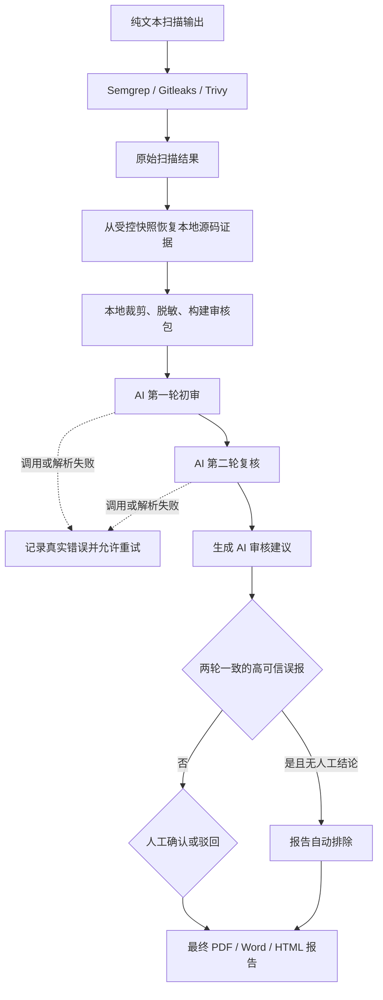

# CodeSentry AI 双轮复核流程

本文记录 CodeSentry 从原始扫描结果到最终 PDF/Word/HTML 报告的审核流程。AI 不会修改人工结论；最终报告可以自动排除满足严格条件的高可信误报。问题台账可查看批量任务进度、两轮结论和失败原因，并可对失败项重新审核。

## 流程总览

## 各阶段说明

| 阶段 | 处理内容 | 结果 |
| --- | --- | --- |
| 纯文本扫描输出 | 接收扫描器产生的结构化或纯文本结果 | 保留原始扫描证据 |
| Semgrep / Gitleaks / Trivy | 执行代码规则、密钥和依赖相关检查 | 形成扫描命中项 |
| 原始扫描结果 | 保存扫描器、规则、文件路径、行号、描述和代码片段 | 写入扫描批次及问题记录 |
| 本地源码证据恢复 | 对扫描快照中可读取的命中位置回读行号及上下文，避免用占位符代替本地判断证据 | 问题台账和报告可展示真实源码上下文 |
| 本地裁剪、脱敏、构建审核包 | 基于本地证据重新裁剪；限制片段长度；密钥、令牌和私钥在发送前替换为 `<REDACTED>` | 形成发送给 AI 的最小数据包 |
| AI 第一轮初审 | 对问题是否成立、证据是否充分进行独立判断 | 输出初审结论和可信度 |
| AI 第二轮复核 | 基于同一份脱敏证据再次独立判断 | 输出复审结论和可信度 |
| 生成 AI 审核建议 | 汇总两轮结果，识别一致、冲突或证据不足的情况 | 输出综合建议和综合可信度 |
| 执行跟踪与失败处理 | 记录任务进度、每个问题的两轮结果和真实失败原因；失败结果不显示虚假的 `0%` 可信度 | 支持查看执行详情和重新审核 |
| 自动误报判定 | 两轮均返回 `FALSE_POSITIVE`，结论无冲突，两轮最低可信度达到配置阈值，且不存在人工结论 | 仅在报告视图中排除，不修改原始问题或人工结论 |
| 人工确认或驳回 | 人工结合完整代码、调用链和运行环境确认风险 | 写入正式人工结论；人工结论始终优先于 AI |
| 最终 PDF / Word / HTML 报告 | 导出人工误报与 AI 高可信误报过滤后的问题及其余 AI 辅助信息 | 形成整改报告 |

## 数据边界与安全要求

1. 原始扫描结果和 AI 审核记录分开保存；AI 不会覆盖原始扫描证据。
2. 问题台账和报告使用本地扫描快照恢复源码上下文；该本地展示与发送给 AI 的审核包是两条独立数据链路。
3. 发送给外部模型前，必须重新在本地完成裁剪和脱敏，只发送规则元数据、仓库相对路径和必要代码片段。
4. Gitleaks、Trivy 及其他密钥类命中值不得发送给模型，真实凭据需要在审核包中替换为 `<REDACTED>`。
5. 代码片段应限制长度，避免无关代码和压缩文件内容进入审核包。
6. AI 不写入人工复核状态。报告筛选和导出属于只读派生视图，不新增、修改或删除原始扫描结果、AI 记录和人工结论。

## 结论处理规则

- 两轮均确认风险：标记为待人工确认的高可信建议。
- 两轮均认为误报、两轮最低可信度达到 `high-confidence-percent` 且该问题没有人工结论：最终报告自动排除。
- 两轮结论冲突：必须进入人工复核，不得自动关闭问题。
- 证据不足：报告中显示结论和可信度，但不能直接作为漏洞定论。
- 调用失败或响应解析失败：标记为“审核失败”，展示真实错误原因，不展示可信度，并允许单项重新审核。
- 模型响应解析：兼容 JSON 前后的说明文字；无法取得完整 JSON 或响应因长度限制被截断时，明确记录为失败，不生成伪结论。
- 已确认的 `FALSE_POSITIVE`：从问题台账和最终 PDF、Word、HTML 报告中隐藏，原始扫描证据继续保留。
- 人工结论优先：只要人工已标记为确认风险、接受风险或已整改待验证，即使 AI 判断为误报也不得自动排除。
- 自动排除只接受当前 `codesentry-ai-review-v2` 协议且两轮输入摘要一致的完整结果；旧版审核结果需要重新执行批量 AI 审核。

## 执行详情

问题台账中的“执行详情”用于查看当前批量任务的执行过程，包括：

- 任务编号、模型、开始时间、整体进度及完成/失败数量；
- 每个问题的初审状态、复审状态、两轮结论和审核依据；
- 调用异常、响应截断或 JSON 解析失败等真实错误信息；
- 任务执行期间手动刷新和自动轮询后的最新状态。

## 报告筛选与展示

整改报告列表和 HTML、Word、PDF 导出统一使用同一套筛选、去重与统计口径：

- 排除人工已经确认的误报；
- 排除符合严格条件的 AI 双轮高可信误报；
- 在筛选完成后重新计算“当前问题”和“新增问题”数量；
- 报告中不保留已排除问题的卡片、条目或“误报已排除”数量说明；
- 导出只读取数据，不修改问题记录、AI 审核记录或人工结论。

最终报告中的“AI 双轮复核”仅展示中文摘要字段：

- AI 初审结论和可信度；
- AI 复审结论和可信度；
- AI 综合建议和综合可信度。

报告不直接展示模型返回的原始英文长段落。扫描器名称、规则 ID 和漏洞原始标题仍可保留扫描器原文，便于定位规则和复现问题。
