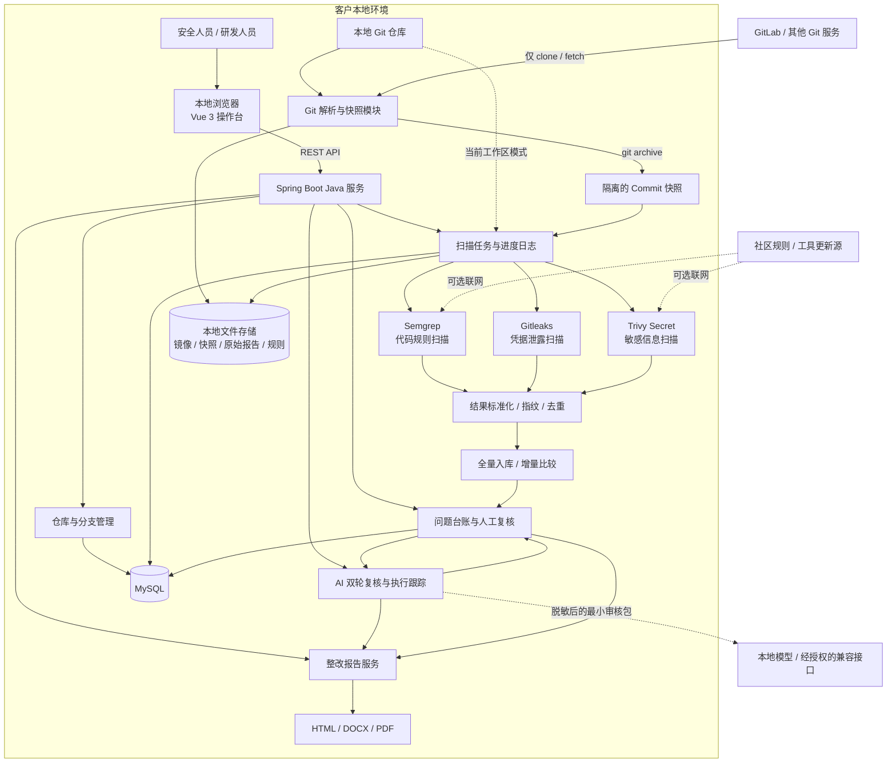

# CodeSentry 技术调研方案总结

> 文档版本：V1.1（2026-09-12）

## 1. 项目背景

本项目拟建设一套本地化代码安全扫描与审查产品，解决开源扫描工具结果分散、缺少增量比较、无法人工复核以及整改报告不统一等问题。

核心需求如下：

- 不采购商业扫描平台，不使用 SonarQube。
- GitLab 只作为代码来源，不依赖 GitLab CI、Runner、API、MR 或安全看板。
- 支持扫描已有本地 Git 仓库，也支持通过标准 Git 地址拉取远程仓库。
- 支持全量扫描和基于指定基线分支的增量审查。
- 产品主体采用 Java 实现，前端采用 Vue，数据保存到本地 MySQL。
- 允许人工介入，对扫描结果进行确认、误报判断和风险接受。
- 支持 AI 双轮辅助复核、执行过程查询、失败重试和严格条件下的报告误报过滤。
- 支持生成 HTML、Word、PDF 整改报告。

## 2. 调研结论

本次调研最终选择建设 CodeSentry 本地代码安全审查平台，采用：

> Java 模块化单体 + Vue 操作台 + MySQL + 本地文件存储 + Git 快照 + 多扫描器适配器

Semgrep、Gitleaks、Trivy 作为底层扫描引擎，CodeSentry 负责仓库管理、任务编排、进度日志、结果标准化、问题去重、增量比较、人工复核和报告生成。

该方案不是重新开发一套代码扫描算法，而是将成熟开源扫描能力整合为可管理、可追踪、可复核、可交付的本地安全审查产品。

## 3. 约束条件与方案对比

### 3.1 硬性约束

以下内容属于本项目的前置约束，不是对相关产品技术能力的否定：

- 项目明确不使用 SonarQube。
- GitLab 只能作为标准 Git 代码来源。
- 当前没有商业软件采购预算。
- 源码和扫描数据需要保留在客户本地。
- 产品业务和编排层需要由 Java 实现。

因此，SonarQube、深度绑定 GitLab 平台能力的方案和需要付费授权的商业平台不进入本阶段实施范围。

### 3.2 统一维度比较

| 方案 | 平台依赖 | 本地数据控制 | 治理闭环 | 成本与维护 | 适配结论 |
|---|---|---|---|---|---|
| SonarQube | 独立服务和数据库 | 支持本地部署 | 产品能力成熟 | 无论社区版或其他版本都需要部署、升级和规则运营 | 因项目明确不使用 Sonar，且需要自主流程，不采用 |
| GitLab 安全扫描 | 依赖 GitLab CI、Runner 和平台功能 | 取决于 GitLab 部署方式 | 与流水线、MR 结合紧密 | 需要维护 GitLab 扫描链路 | 与“GitLab 只用于拉取代码”冲突，不采用 |
| 商业 SAST/SCA | 取决于厂商产品 | 云端、本地或混合部署均可能 | 通常较完整 | 存在授权和厂商依赖，仍需核验具体部署的数据边界 | 当前无采购预算，不采用 |
| 单个开源扫描器 | 依赖较低 | 本地执行可控 | 缺少统一批次、复核和报告 | 工具免费不等于无维护成本 | 作为底层扫描引擎 |
| CodeSentry | 标准 Git、本地 CLI、MySQL | 源码和治理数据保留本地 | 按项目需要自主建设 | 无商业授权费用，研发和规则维护由项目团队承担 | 最符合当前约束，采用 |

## 4. 总体架构

## 5. 各层职责

| 层次 | 技术与组件 | 主要职责 |
|---|---|---|
| 展示层 | Vue 3、TypeScript、Vite | 仓库登记、发起扫描、查看进度、问题复核和报告导出 |
| 产品服务层 | JDK 11、Spring Boot | REST API、业务规则、任务状态、扫描编排和报告生成 |
| AI 辅助复核层 | OpenAI 兼容协议、本地脱敏、双轮独立判断 | 批量审核、单项重试、执行详情、冲突识别和高可信误报建议 |
| Git 处理层 | 标准 Git CLI | 分支解析、Commit 解析、merge-base、mirror clone/fetch、快照导出 |
| 扫描执行层 | Semgrep、Gitleaks、Trivy Secret | 代码规则、凭据泄露和敏感信息扫描 |
| 数据层 | MySQL 5.7+ | 项目、扫描批次、工具执行、问题实例和人工复核数据 |
| 文件存储层 | `~/.codesentry` | Git 镜像、current/baseline 快照、原始 JSON 报告和本地规则 |
| 报告层 | Apache POI、OpenHTMLToPDF | 生成 HTML、DOCX 和 PDF 整改报告 |

## 6. 全量与增量扫描设计

### 6.1 全量扫描

全量扫描对所选工作区或 Commit 快照执行所有可用扫描器，对结果进行标准化、指纹计算和去重，再将本批次问题登记为 `NEW`。

### 6.2 增量审查

增量审查流程如下：

1. 解析扫描分支的目标 Commit。
2. 解析用户选择的基线分支 HEAD。
3. 计算两者的 `merge-base` 共同祖先。
4. 分别导出当前 Commit 和 merge-base 快照。
5. 使用同一组扫描器扫描两个版本。
6. 对标准化问题指纹进行集合比较。
7. 输出 `NEW`、`EXISTING`、`FIXED` 状态。

使用 merge-base 可以避免把基线分支分叉后的新提交错误纳入扫描分支的变化范围。第一阶段采用双侧实际扫描，优先保证比较过程可解释；后续可通过基线缓存降低重复扫描成本。

当前增量指纹仍需完成仓库相对路径归一化和真实分支回归验收。在验收完成前，应将其描述为“增量流程已实现、准确性待交付验证”。

## 7. 扫描器选型

| 扫描器 | 当前作用 | 选型原因 |
|---|---|---|
| Semgrep | 代码模式、常见漏洞和自定义规则 | 多语言支持较好，规则可读，可建立本地规则库 |
| Gitleaks | API Key、Token、私钥等硬编码凭据 | 专注凭据泄露，扫描速度快，规则较成熟 |
| Trivy Secret | 文件系统敏感信息补充扫描 | 补充凭据风险检测，并为后续能力扩展预留入口 |

扫描器通过统一 Java 适配器接口接入。新增扫描器时需要开发适配器、完成测试并重新发布产品，但无需重写仓库、批次、问题台账和报告模块。

## 8. 为什么采用该架构

### 8.1 本地优先

扫描执行、结构化结果和报告生成都在客户本地完成。CodeSentry 本身不设计源码上传接口，适合对源码外发敏感的场景。

远程 Git 拉取、Semgrep 社区规则、工具更新和 CLI 遥测可能产生网络访问，交付前需要根据客户要求核验访问域名、遥测配置和离线策略。

### 8.2 模块化单体

当前定位是单机本地产品，首期采用 Java 模块化单体，不引入微服务、消息队列和分布式扫描节点。

主要原因：

- 部署组件少，客户安装和问题排查更简单。
- 符合现有 Java 团队的技术能力。
- 当前仓库规模下无需承担分布式系统复杂度。
- 内部模块边界清晰，未来仍可拆分扫描执行节点。

### 8.3 Git 隔离快照

分支扫描使用 `git archive` 导出指定 Commit：

- 不切换用户当前分支。
- 不修改用户工作区。
- 不创建 worktree。
- 便于记录和复现被扫描的源码版本。

完整复现一次扫描还依赖扫描器版本、规则版本、执行参数和运行环境；这些信息需要在交付验收和后续版本治理中继续固化。

当前工作区模式则允许直接扫描尚未提交的代码，并记录工作区是否存在未提交修改。

### 8.4 数据库与文件分离

MySQL 保存便于查询的项目、批次、问题和人工复核数据；Git 镜像、快照和原始扫描报告保存到本地文件系统。

这种方式避免把大型仓库和原始报告写入数据库，同时保留结构化查询和执行追踪能力。

### 8.5 自动扫描与人工复核结合

自动规则只能识别已知风险模式，不能完整理解业务授权和设计上下文。CodeSentry 提供以下人工结论：

- 确认风险。
- 误报。
- 接受风险。
- 已整改，等待复扫验证。

复核结果可以记录复核人、说明和风险接受有效期，从而形成扫描、确认、整改、复扫和报告的治理闭环。

### 8.6 AI 双轮复核与报告收敛

规则命中后，系统可将本地裁剪、脱敏后的最小证据依次交给 AI 初审和独立复审。两轮结果分别保存，并根据结论一致性、最低可信度、证据摘要和协议版本生成综合建议。人工结论始终优先，AI 不会覆盖人工复核状态。

批量审核支持查看任务进度、逐问题的初审/复审结果及真实失败原因。模型返回说明文字包裹的 JSON 时可提取结构化结果；响应被截断、JSON 不完整或接口异常时明确标记为审核失败，不显示虚假的 `0%` 可信度，并允许重新审核。

整改报告列表与 HTML、DOCX、PDF 导出共用同一套只读筛选、去重和统计逻辑。人工误报及符合严格条件的 AI 双轮高可信误报不进入最终报告；报告不保留已排除条目或排除数量，也不会在导出时修改任何原始记录。

## 9. 主要优势

1. **成本可控**：核心扫描能力来自开源工具，无商业平台按人数或代码量授权费用。
2. **源码可控**：扫描过程和结果保留在客户本地。
3. **GitLab 解耦**：只使用标准 Git 协议，不绑定 GitLab 平台功能。
4. **接入灵活**：支持已有本地仓库和远程 Git 镜像。
5. **不干扰开发**：Commit 快照不切换或修改开发者工作区。
6. **过程可追踪**：扫描批次、执行进度、工具状态和日志均可查询。
7. **结果可治理**：支持批次查询、本地源码上下文、AI 双轮建议、人工复核和风险接受。
8. **失败可识别**：扫描器不可用或失败时标记为部分完成，不伪装成零问题。
9. **AI 过程可追踪**：支持批量进度、两轮结果、失败原因和单项重试。
10. **报告口径一致**：报告列表与三种导出格式统一过滤、去重和统计，导出不修改原始记录。
11. **交付可归档**：支持导出 HTML、Word 和 PDF 整改报告。
12. **便于扩展**：可以逐步增加规则集、扫描器适配器和兼容模型服务。

成本可控不等于零成本，仍需要承担部署升级、规则运营、误报治理、数据备份以及开源许可证核查工作。

## 10. 实现与验收状态

本节使用以下口径：

- **源码已实现**：当前代码中已经存在相应模块和调用链。
- **专项检查通过**：此前已执行过针对性检查，但不等于完整生产验收。
- **待交付验收**：仍需在当前构建和客户代表性仓库上完成端到端验证。

| 能力 | 当前状态 | 代码或检查依据 | 仍需验证 |
|---|---|---|---|
| 本地/远程仓库登记与分支查询 | 源码已实现 | `project`、`GitRepositoryService` | 私有仓库认证、大仓库拉取 |
| mirror clone/fetch、Commit、merge-base | 源码已实现 | `GitRepositoryService` | 客户 Git 服务兼容性 |
| 不使用 worktree 的 Commit 快照 | 源码已实现 | `RepositorySnapshotService` | 子模块、LFS、符号链接边界 |
| 全量扫描流程 | 源码已实现 | `ScanOrchestrator` | 当前版本端到端复跑 |
| 增量扫描流程 | 源码已实现、待关键验收 | `ScanOrchestrator`、`FindingFingerprintService` | 仓库相对路径归一化及 NEW/EXISTING/FIXED 回归 |
| Semgrep、Gitleaks、Trivy Secret | 源码已实现 | 三个 `ScannerAdapter` 实现 | 版本固定、超时、离线和失败降级 |
| 本地/社区/综合规则集 | 源码已实现 | `RuleProfileService`、本地 YAML 规则 | 社区规则版本、缓存和许可证条款 |
| 扫描进度、工具状态和执行日志 | 源码已实现 | `scan_tool_run`、扫描详情页 | 长任务、异常退出和恢复 |
| 问题批次、代码片段和人工复核 | 源码已实现，前端曾做专项检查 | `FindingsView.vue`、`scan_triage` | 当前构建复跑、复核历史 |
| 本地源码上下文恢复 | 源码已实现，专项单元测试覆盖 | `SourceSnippetExtractor`、`FindingPersistenceService` | 快照缺失、编码异常及敏感信息交付策略 |
| HTML、DOCX、PDF 报告 | 源码已实现 | `ReportController`、`RemediationReportService` | 当前构建、中文字体和客户办公软件兼容性 |
| AI 双轮辅助复核 | 源码已实现，包含执行详情、失败原因和单项重试 | `ai` 模块、`scan_ai_review`、`FindingsView.vue` | 经授权的真实模型端点与代表性代码联调 |
| 报告误报过滤与统计一致性 | 源码已实现，专项单元测试覆盖 | `RemediationReportService`、`ReportsView.vue` | 大批次报告性能及三种格式兼容性 |

本次已使用用户指定的 Maven settings 完成后端单元测试，并完成前端生产构建。该结果证明当前源码可编译且专项测试通过，不代表真实模型端点、MySQL 初始化、PDF 中文字体或客户代表性仓库的端到端验收已经完成。

## 11. 当前边界

| 当前边界 | 影响 |
|---|---|
| 本地规则库目前只有 7 条起步规则 | 不能代表已经覆盖全部行业安全规范 |
| 社区规则依赖外部 Registry | 网络或 TLS 异常可能导致社区规则执行失败 |
| 增量指纹路径归一化尚待完善 | 绝对路径差异可能影响 NEW/FIXED 判断 |
| 当前采用单机线程池 | 不适合大量仓库同时并发扫描 |
| 当前为本地单用户产品 | 暂无认证、RBAC 和完整审计日志 |
| Trivy 默认只启用 Secret | 当前不能宣称具备完整 SCA 能力 |
| Gitleaks 使用目录扫描 | 不等于扫描完整 Git 提交历史 |
| 快照不完整处理子模块、LFS 和符号链接 | 特殊仓库需要制定额外策略 |
| 人工复核保存最新状态 | 尚未形成不可变的复核版本历史 |
| 本地源码证据可能包含真实凭据 | 需要限制页面、报告和存储目录访问，并在对外交付前按约定处理敏感值 |
| 原始扫描报告可能含敏感证据 | 必须限制本地存储目录权限和保留周期 |

## 12. 后续建设建议

### 第一优先级：完成交付验收

- 修复增量指纹的仓库相对路径归一化。
- 使用真实分支验证 `NEW`、`EXISTING`、`FIXED`。
- 固定扫描器版本并记录规则版本。
- 验证社区规则失败时的本地规则降级策略。
- 验证 Word/PDF 中文字体和客户办公软件兼容性。

### 第二优先级：扩大规则与治理能力

- 建立通用、行业、客户自定义三级规则体系。
- 增加规则版本、测试样例、白名单和回滚机制。
- 增加复核历史、报告快照和操作审计。
- 增加认证、角色和数据权限。

### 第三优先级：提升规模化能力

- 增加基线扫描结果缓存。
- 增加任务配额、资源限制和取消机制。
- 根据实际并发规模拆分独立扫描节点。
- 按需增加 SCA、配置检查和更多语言扫描器。

## 13. 总结

CodeSentry 选择的是一条“开源扫描引擎 + 自主治理平台”的路线。

该架构把成熟开源工具负责的漏洞发现能力，与企业实际需要的仓库管理、扫描批次、增量比较、人工复核和整改报告结合起来。在不依赖商业平台和 GitLab 扩展能力的前提下，实现代码安全检查本地化、过程可追踪、结果可治理。

现阶段最重要的不是继续增加架构复杂度，而是完成增量准确性、规则版本、离线能力和报告兼容性的交付验收，再根据客户规模逐步扩展规则、权限、审计和分布式执行能力。

> 方案核心关键词：**本地可控、增量可解释、结果可治理、能力可扩展。**
